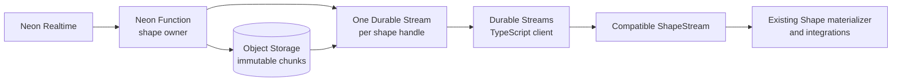

# Neon shapes over Durable Streams

Exploration, 15 October 2026. This is the latest proposed direction: replace Electric's HTTP transport with Durable Streams while preserving the TypeScript `ShapeStream` and `Shape` APIs. It builds on the [earlier compatibility exploration](./electric-compatibility-exploration.md).

The [implementation and testing plan](./implementation-and-testing-plan.md) specifies the monorepo, client fork, package aliasing, compatibility gates and delivery milestones.

## Recommendation

**One shape handle identifies one Durable Stream, with the handle in the existing `handle` query parameter.** The configured endpoint path stays unchanged. Durable Streams supplies ordered HTTP delivery and replay; Neon supplies shape evaluation, lifecycle, schema and snapshot semantics. The browser uses the existing Durable Streams TypeScript reader beneath a compatible Electric client facade.

The working assumptions remain request affinity, a maximum shape lifetime of 15 minutes, and invalidation when the owning Function or continuous upstream subscription is lost. The new transport does not require a distributed registry or seamless worker recovery under those assumptions.

**Current implementation/test target:** use Sam's staging Neon workspace for Postgres/Realtime and run the Function locally with `neon dev`. Platform affinity is not available yet, so deployed Function testing is deferred. Single-process ownership and simulated routing let us validate the application locally; actual platform guarantees remain future gates. See [testing environment](./docs/testing-environment.md).



This is a proposal based on source inspection. It has not been implemented or tested end to end.

## Shape identity and URL compatibility

**Existing proxy URLs, methods and Electric query-parameter conventions are a compatibility requirement.** Keep exactly the URL supplied through `ShapeStreamOptions.url`, including an application-defined path and existing query parameters. Do not append handle, descriptor or snapshot path segments, introduce a mandatory bootstrap POST, redirect the browser to a native Function URL, or require a new protocol-selector parameter.

For an application that already proxies `/api/shape`, requests remain:

```text
GET    /api/shape?table=items&offset=-1
GET    /api/shape?table=items&handle=abc&offset=0000000000000000_0000000000000042
GET    /api/shape?table=items&handle=abc&offset=...&live=true&cursor=...
GET    /api/shape?table=items&handle=abc&offset=...&subset__where=...
POST   /api/shape?table=items&handle=abc&offset=...   existing POST-subset mode
DELETE /api/shape?table=items&handle=abc              when deletion is supported
```

The first GET without a handle authorizes and creates the shape, then promptly returns handle metadata and an initialization event without waiting for baseline readiness. Finish that short response and let ordinary reads on the same URL follow initialization. Include schema when available and always before row data; resumed row responses also provide the schema needed to parse a noninitial offset. Record the handle at the fetch response-header boundary so a subsequent body failure can resume it. Obtain metadata through these existing reads; there is no mandatory descriptor request or HEAD round trip. HEAD can be supported on the same endpoint for native Durable Streams clients, without making it a new requirement for GET-only application proxies.

`new ShapeStream({ url, params, ... })` remains the application API. Keep the original query construction and parameter serialization, including `table`, `where`, `columns`, `params`, `replica`, `log`, `offset`, `handle`, `cursor`, `live`, SSE parameters, subset parameters and custom application params. Preserve the exported `ELECTRIC_PROTOCOL_QUERY_PARAMS` values used by proxy allowlists. Shape definitions remain on subsequent requests too, since proxies can use them for authorization or inject their own trusted definitions.

Durable Streams accepts implementation-defined stream URLs: the query parameter supplies identity just as a path component could. Store/routable identity is the authorized shape context plus `handle`; changing `offset` or `cursor` does not create a different stream or owner. Initial requests may independently create different handles for identical definitions. Canonical deduplication is optional.

Use the real Durable Streams reader with its supported custom-fetch hook for the compatibility boundary. Map its native live-mode requests to the existing Electric URL conventions (`live=true`, existing SSE flags), retain the handle on every read, and normalize response-header aliases before the reader sees the response. The server can accept native Durable Streams live values on the same endpoint as well. The raw reference server needs a test adapter because its current store keys use paths; do not change browser URLs to accommodate that implementation.

The Function emits the required `Stream-*` headers for native readers and compatible `electric-handle`, `electric-offset`, `electric-schema`, `electric-cursor` and `electric-up-to-date` aliases. The facade can normalize the Electric aliases when an existing proxy forwards only those headers. Obtain shape/schema information there, rather than requiring a new response document or endpoint. Use existing authentication headers and query forwarding; do not add a mandatory custom request header for transport negotiation.

This targets unchanged pass-through and Electric-parameter/header-allowlist proxies, validated with actual proxy fixtures. A proxy that parses or rewrites Electric message bodies has a separate payload dependency that URL/header compatibility alone cannot satisfy; record its behavior rather than claiming it passes without a test. The backend upstream must ultimately target the new service, whether through deployment configuration or replacement at its existing origin.

The Durable Streams specification explicitly permits independent read and write implementations, using database synchronization as its example. Browser-facing shape streams need not expose arbitrary append, create-by-URL, producer coordination or forking. Changes can be injected internally. Initial creation and existing GET/POST subset requests are dispatched at the same configured shape endpoint; POST subsets must not be mistaken for generic stream appends.

## What we can reuse

| Component | Reuse and remaining work |
|---|---|
| `@durable-streams/client` | Use `stream()` and `subscribeJson()` for catch-up, long polling/SSE, cursors, retries, cancellation and ordered asynchronous consumption. Adapt Electric's documented options and lifecycle behavior. |
| Electric `Shape` | Its constructor already accepts `ShapeStreamInterface<T>`. Reuse the materializer and its notification/reset behavior. |
| Electric parsing and helpers | Keep Postgres parsers, column mapping, transformations, expression compilers, message types and exported helpers. |
| Durable Streams reference server | Useful local fixture for proving the bridge before implementing Function delivery and Object Storage. |
| Durable Streams server conformance suite | Exercise delivery semantics, headers, offsets, JSON, SSE, caching, expiry and errors against our implementation. |
| Electric client/integration tests | Check the public client contract and real React/TanStack behavior on top of the new transport. |

The inspected Node reference server is a `node:http` test server with built-in memory/file stores. It does not expose a documented Fetch handler or injectable Object Storage backend. It is useful source and test infrastructure, but it is not an established plug-in Neon Function server. We still need to extract/adapt its handler and storage boundary or implement the read path against the specification.

## Keep transport and shape semantics separate

Use Durable Streams `application/json` mode. Its JSON messages retain boundaries, but one HTTP response or `subscribeJson()` callback may contain multiple messages. A top-level array appended to a JSON stream is flattened one level. Do not use an array alone as an implicit atomic publication.

A small, versioned Neon shape envelope can carry:

| Envelope | Meaning |
|---|---|
| Initialization | The authorized handle exists; baseline construction is in progress |
| Snapshot chunk | Initial insert messages; several chunks may form one baseline |
| Snapshot complete | The baseline is installed, with its associated MVCC evidence and any available frontier |
| Publication | One complete Realtime publication, including row changes, batch txids and commit frontier |
| Progress | Ordered MVCC evidence, including when there are no visible row changes |

Every stream envelope has a version, kind and stable per-handle logical `seq`: a strictly increasing decimal string, compared as an integer without conversion to a JavaScript number. The owner's serialized row-update/append queue assigns it. Preserve it across replay, object sealing and HTTP response grouping; a new handle starts a new epoch. Committed transport bytes and offsets remain immutable too. Logical sequence, Durable Streams resume offset and PostgreSQL LSN are three different positions.

For the POC, one complete publication fits in one JSON object containing its changes. If large publications must be split later, add explicit parts and a completion marker. Only advance the application commit boundary or capture a subset cut after the complete publication is available. Baseline completion and progress explicitly identify their installed/covered data boundary and follow that data. Initial snapshots may span many messages without exposing a partially loaded shape as ready.

The real reader's `subscribeJson()` batch has a single response-end offset even when it contains several publications. That offset is a resume checkpoint, not the logical position of each item. Consume all envelopes before committing that checkpoint; if processing is interrupted, replay from an earlier checkpoint and use sequences to avoid applying an already-consumed event twice. This distinction is required from version 1, before subset support is implemented.

The row messages inside these envelopes can preserve Electric's existing `key`, `value`, `old_value` and headers. Keeping that payload does not require implementing Electric's HTTP protocol. The facade unwraps the envelopes, applies the existing parser and mapper, and emits the existing public `Message<T>[]` callbacks.

**Durable Streams up-to-date and shape up-to-date are different facts.** A reader can reach the stream's current tail while the producer is still constructing the baseline. The facade needs an explicit baseline-complete barrier before reporting the shape as ready. Likewise, reaching the tail between parts of a publication must not expose half a batch as complete. The transport must continue reporting its actual tail correctly; enforce shape readiness above it.

The initial GET must respond before an existing proxy's response timeout even when the baseline is slow or the SDK buffers it. An early initialization event makes that possible. Schema discovery must also respect this response budget; it cannot depend on receiving the complete baseline. For `subscribe: false`, the facade must reopen catch-up reads until the baseline-complete barrier and all covered data are installed, even if a Durable Streams `live: false` session stops at an earlier temporary tail. Use cancellation, expiry and bounded retry/backoff rather than a busy loop. Then stop at the compatible one-shot completion boundary. Continuous readers follow the same readiness rule before entering normal live delivery.

`changes_only` and `offset=now` need the same care. A newly created shape may need to hydrate privately before selecting a live starting boundary. Resolving `now` against an empty stream before the baseline is appended would incorrectly deliver the later baseline as live data. Capture the intended boundary after initialization, and retain subsequent changes while the client attaches.

Expose ordered baseline MVCC, publication txids/frontiers and progress from Realtime. The underlying wire protocol already has these ingredients; the current public callbacks hide some of them. Preserve precise Postgres cell representations and schema information for Electric's existing value parsing. A pinned, committed pnpm patch of the SDK is a valid POC route to expose existing metadata before an upstream release. Patch the exported runtime and declaration artifacts, test the actual ordering against Realtime and isolate the dependency in the server adapter. See the [SDK patch procedure](./implementation-and-testing-plan.md#neon-realtime-sdk-patches); a patch cannot create missing engine guarantees.

## Why not use Durable State directly?

The State protocol is related to Electric and provides useful insert/update/delete conventions. It is not an exact substitute for the Electric client contract:

- State updates replace the complete entity value; Electric updates may contain only changed columns.
- State adds an entity `type` and has a simpler transaction identifier and control-message model.
- Its published JSON schema rejects additional fields in headers and lacks Electric's MVCC, subset and dependency metadata.
- Its materializer does not implement Electric `Shape`'s readiness and notification semantics.

Use the base Durable Streams protocol with a Neon shape payload initially. Adopting or extending the State protocol can be a separate interoperability decision. Do not claim the richer payload conforms to its current schema without an explicit extension.

## Making the client a practical replacement

Pin a compatibility target, initially `@electric-sql/client@1.5.28`. Refactor or fork its client around a transport boundary rather than rewriting its public API and parsing behavior from scratch. `ShapeStreamInterface` is an excellent materializer seam, although the concrete class has additional public members such as `options` and `isPaused()` that also need preserving.

The compatibility inventory includes constructor generics, all options, subscription/backpressure behavior, error classes and retry callbacks, status/timestamps, cancellation, refresh, parser/transformer ordering, column mapping, snapshots, exports and platform entry points. Keeping method names and row types alone would be insufficient.

Two details deserve deliberate choices:

1. **Offsets.** Electric's public `Offset` type accepts `-1`, `now` or a numeric pair; Durable Streams offsets are opaque but lexicographically ordered. Generate zero-padded numeric-pair offsets, as the reference server does, to satisfy both contracts. Keep WAL LSNs separate. In particular, replace Electric's SSE-specific LSN-to-offset assumptions rather than deriving a Durable Streams cursor from `global_last_seen_lsn`.
2. **Package identity.** React and TanStack integrations import `@electric-sql/client` themselves, and TanStack constructs `ShapeStream` internally. Changing only the application's import does not replace those instances. A POC should alias/override the module throughout the dependency graph and verify a single implementation is resolved. This also avoids two copies of error classes. Classes with private fields from separate declarations can fail TypeScript assignability despite matching public methods; test actual consumer projects, not just a structural interface.

Reusing the copied `Shape` implementation preserves its tested behavior, not nominal identity with an independently installed original class. The client fork has no runtime dependency on the original package. Resolve the replacement consistently throughout the application and its integrations so they share one implementation and one set of error classes; verify that with packed-package fixtures.

Custom `fetchClient` remains at the outward network boundary: it receives the preserved endpoint/method/query conventions, and its response is normalized for the Durable Streams reader afterward. Preserve the Electric metadata-header aliases for existing header-aware hooks and proxies. Code that parses the old Electric payload body has a separate payload contract and needs a dedicated compatibility test.

## Subsets become easier to design

We now control both producer and client. An independent subset can return an additional **logical cut in the same shape stream**, identifying the materialized state used to produce its rows. Reconciliation can use that cut rather than infer everything from originating WAL operations. This is private transport metadata alongside truthful public `SnapshotMetadata`, not a replacement for its PostgreSQL fields.

A candidate design is:

1. Serialize subset capture with the owner's row-state updates and choose a logical sequence cut `C` after a complete baseline/publication state boundary, including any ordered progress already applied.
2. Capture the matching rows from precisely that state, using a stable copy or equivalent protection while evaluating the subset.
3. Return those rows plus `cutSeq: C` and, separately, any resume checkpoint known to be at or before the cut. Do not substitute an HTTP response's end offset for `C`.
4. Serialize snapshot injection with the client's normal delivery. Classify each publication using its logical sequence, even when a single response contains publications on both sides of `C`. Prevent replayed changes at or before `C` from overwriting the snapshot's returned keys, then apply subsequent changes in order. Preserve/reapply later changes that arrived before the delayed subset response so injection cannot roll them back.

This is promising but still needs proof with deletes, overlapping requests, reconnects, batches straddling a cut, interrupted replay and cold `changes_only` subscriptions. Arbitrary Postgres subset predicates/orderings also need a correct evaluator over that retained state, or a coordinated database snapshot path. A query against current Postgres followed by an unrelated Function offset is not a consistent cut.

There is also a public compatibility obligation: `SnapshotMetadata` exposes `xmin`, `xmax`, `xip_list`, `database_lsn` and `snapshot_mark`; consumers such as TanStack use snapshot evidence. Return truthful PostgreSQL evidence when claiming that contract. Do not relabel a stream offset as an LSN or invent snapshot bounds. The newly exposed Realtime metadata may be sufficient for a coordinated path, but its exact correspondence to subset rows remains to be verified.

Thus the new client can simplify its internal reconciliation substantially without pretending that all PostgreSQL snapshot semantics are already solved.

## Affinity, storage and the 15-minute limit

The owner retains its Realtime subscription, row state, log index, active tail, pending readers and absolute expiry. Immutable sealed ranges can live in Object Storage. One serialized local append path assigns offsets and notifies readers. Multiple readers of the same handle share this log; a reconnect does not create a fresh upstream subscription while the handle is valid.

Use **absolute expiry** corresponding to `Stream-Expires-At`. Durable Streams `Stream-TTL` is sliding idle expiry, renewed by reads/writes, so `Stream-TTL: 900` does not express our maximum 15-minute shape lifetime. Also account for the owner's remaining execution lifetime.

Validate application lifecycle early using `neon dev` against staging Realtime: disconnect every browser reader, commit writes and reconnect. If continuity was retained, replay must cover the disconnected interval; otherwise invalidate and refetch. Test expiry, local process kill and simulated dead-owner fallback, then repeat with the final handler. Keep ingestion explicitly bounded by shape expiry and clean it up.

Deployed ingestion lifetime remains a separate future check because platform affinity is not available yet. A bounded `waitUntil` promise tied to expiry is a candidate to confirm with the platform, not an assumed background-worker guarantee. Timers, outbound sockets and affinity alone do not prove the Function keeps running. The documented first-byte, heartbeat and `waitUntil` limits are separate from process lifetime, and local development does not track `waitUntil`. Verify those guarantees, actual idle/eviction and routing/failover before deployed acceptance; they do not block the local POC.

On expiration or owner loss, the handle is invalidated. The router needs a fallback that returns an actionable missing-stream response. The facade handles missing/expired streams, emits the existing `must-refetch` behavior, and obtains a fresh handle through the same configured endpoint. Only the handle query value changes; the browser-facing path and origin stay fixed. Do not reuse a handle for a new history or retry an unreachable owner forever. Preserve Electric's `409 must-refetch` behavior on the compatible surface, normalizing it for the reader as needed; native Durable Streams missing/retention responses can also be handled internally.

The POC's lifecycle is explicitly owner-bound: instance loss can end a shape earlier than its maximum expiry. Passing wire conformance tests does not establish storage survival across crashes. If the product later promises acknowledged bytes survive owner loss until expiry, retain the required log/index metadata durably and publish only after persistence. That stronger guarantee is separate from safe client refetch under the currently accepted model.

The new transport does not remove baseline buffering, retained-row memory, SQL support limits or resync costs. A shape must initialize and catch up within its useful lifetime. Object Storage offloads replay bytes; it does not automatically offload the materialization needed for updates and subsets.

## POC and expansion

Start with the existing Durable Streams reader and a local reference server using controlled input, then attach real staging Neon Realtime. Implement the compatible stream facade and reuse the copied `Shape`. Demonstrate a primary-keyed table, projection and a parameterized filter; a multi-chunk initial snapshot; inserts/updates/deletes and filter membership; and replay from a saved handle/offset. Include slow initialization behind an unchanged proxy, one-shot reads across temporary tails and explicit refetch through the same application API. Run the small local Function lifecycle check alongside the early client work.

Run the Function through `neon dev`, add Object Storage chunk offload and test controlled local owner routing. Use a storage fixture initially and real Neon Object Storage when an appropriate bucket is available, reporting which backend was tested. Include eager React/TanStack integrations and MVCC-based transaction acknowledgement once the ordered metadata API is exposed through the tested SDK patch or release. Long polling, eager full logs, default replica and a documented small type/filter set define the local POC against real staging data. SSE can follow using the same payload and client contract. Deploy and validate actual platform affinity/lifecycle only when that feature becomes available.

Expansion adds SSE, the full parser/type matrix, full replica mode, changes-only/now, mobile lifecycle behavior, broader Realtime-backed root-table filters/subqueries and subset requests. Basic refresh/reset is already part of the eager POC. Preserve all public types early while explicitly documenting unsupported runtime capabilities. The plan's capability matrix makes each new behavior and proxy suite required when that feature is implemented; deferred tests are not passing tests. Test root-row membership separately from exact Electric tags, move events and transaction provenance. Correct materialized rows do not alone prove identical event history or dependency metadata.

## Tests we gain, and tests we still need

Use three layers:

1. **Durable Streams delivery conformance.** Reuse the server suite for the supported read surface and JSON framing. The inspected suite creates and appends test streams; a read-only shape endpoint cannot run the full suite unchanged. Exercise a generic transport test harness using the same handler/store, or select/adapt relevant tests and provide controlled fixture injection. Report the supported surface explicitly. Full suites include producer and fork behavior that our shape service need not expose.
2. **Client API compatibility.** Compare public declarations/exports and compile real applications against the replacement. Run behavior tests for `Shape`, callbacks, options, errors, reset, resume, parsing and refresh; resolve React/TanStack's transitive module imports to the replacement. Reusing an unmodified Durable Streams reader usually makes its client-conformance suite less urgent than these integration checks; rerun it if we modify the reader.
3. **Shape correctness under concurrency and failure.** Test writes during baseline, fragmented publications, empty-shape progress, transaction acknowledgement, reconnect, upload failure, owner death and expiry. Test independent subsets against concurrent inserts/updates/deletes and overlapping cuts before claiming full support.

URL/proxy tests are a release gate within these layers: use the configured proxy URL for every request, keep `handle` in the query string, preserve existing query names/serialization and method choices, and run the real reader behind both transparent and Electric-allowlist proxies. Initially require initialization, one-shot reads, resumed reads, long polling and refetch. Add SSE/subset flows at their capability milestones. A proxy fixture must not be edited to pass the new client.

The conformance suite saves substantial transport work. It does not validate SQL membership, Postgres encoding, MVCC interpretation or Electric API behavior.

## Source anchors

- Durable Streams revision inspected: [`461b40267aabd644558f9b19dbb9507dd5f691cf`](https://github.com/durable-streams/durable-streams/tree/461b40267aabd644558f9b19dbb9507dd5f691cf), downloaded under `research/sources/durable-streams/`.
- [Base protocol](https://github.com/durable-streams/durable-streams/blob/461b40267aabd644558f9b19dbb9507dd5f691cf/PROTOCOL.md): independent read/write implementations, stream model, offsets, JSON mode, expiry and caching.
- [TypeScript reader](https://github.com/durable-streams/durable-streams/blob/461b40267aabd644558f9b19dbb9507dd5f691cf/packages/client/README.md), [reference server](https://github.com/durable-streams/durable-streams/blob/461b40267aabd644558f9b19dbb9507dd5f691cf/packages/server/src/server.ts) and [server conformance suite](https://github.com/durable-streams/durable-streams/blob/461b40267aabd644558f9b19dbb9507dd5f691cf/packages/server-conformance-tests/src/index.ts).
- [State protocol](https://github.com/durable-streams/durable-streams/blob/461b40267aabd644558f9b19dbb9507dd5f691cf/packages/state/STATE-PROTOCOL.md) and its JSON schema were inspected separately from the base transport.
- Electric `1.5.28`: `research/packages/electric-client/package/src/{client,shape,types,parser,index}.ts`; TanStack Electric `0.5.8`: `research/packages/tanstack-electric/package/src/electric.ts`.
- Realtime wire metadata: `<neon-pkgs-checkout>/packages/realtime/schema/realtime-protocol-v1.schema.json` and the transaction-tracker/reconciliation sources referenced in the earlier note.
