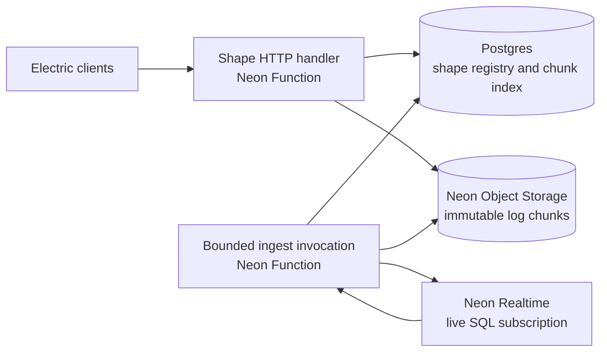

# Electric HTTP compatibility over Neon Realtime

Exploration dated 15 October 2026. Target: a limited POC first, with a path to the full Electric `/v1/shape` API, including advanced shapes and subset snapshots.

**Latest direction:** use one Durable Stream per shape handle and preserve the Electric TypeScript APIs through a replacement transport. Existing shape URLs and query conventions remain mandatory: `handle` stays in the query string, and creation, reads and subsets use the configured endpoint so existing proxies can keep their routes. See [Neon shapes over Durable Streams](./durable-streams-shape-design.md) and the [implementation/testing plan](./implementation-and-testing-plan.md), which define prompt initialization, logical event sequences, phased capability gates and the early Function lifecycle check. The earlier Electric wire-format design below remains background; the new payload/delivery protocol is Durable Streams with the required URL/header compatibility boundary.

**Current testing agreement:** use Sam's Neon staging workspace for Postgres/Realtime and run the Function locally with `neon dev`. Platform affinity is not available yet; deployed Function testing is deferred. The current plan's local POC and simulated routing tests do not claim actual platform affinity or lifecycle verification. See [testing environment](./docs/testing-environment.md).

## Updated working assumptions: affinity and disposable shapes

The latest proposal assumes that every request for a handle reaches the same live Function instance, every shape has a maximum lifetime of 15 minutes, and losing the instance also loses its shapes. Under those assumptions, the implementation can be substantially smaller than the general architecture considered below.

**We can aim for a useful Electric compatibility service, including most ordinary eager shape-sync flows, without first building durable writer recovery.**

Each Function keeps a local map:

```text
handle -> {
  definition, expiresAt, subscription,
  rowsByRealtimeId, electricKeys,
  chunkIndex, inMemoryTail, headOffset, waitingRequests
}
```

An initial request creates a subscription and a fresh unguessable handle. Requests carrying that handle return to its owner. An expired or missing handle returns `409 must-refetch`. A new Realtime baseline after a lost subscription also expires the handle, so the adapter never claims to have reconstructed a missing history.

No persistent shape registry, cross-instance lease, durable manifest, or worker handoff is required for this model. Per-shape work still needs local serialization because one instance can handle concurrent requests.

Handle affinity is enough for correctness. Initial requests for the same shape definition can create separate handles on different instances. Affinity by canonical shape definition and deduplication can improve sharing later; they are not prerequisites for this POC.

Object Storage becomes a way to offload immutable chunks and serve repeated reads. The chunk index and active tail can remain in memory. It is also valid to serve a retained memory tail before upload, provided it remains available for the handle's lifetime or until safely uploaded; crash durability is not promised because a crash invalidates the handle. This relaxes the write-before-publish requirement in the earlier, durable-recovery design below.

| Capability | Assessment with disposable, affinitized shapes |
|---|---|
| Full initial snapshot, pagination, long polling, offsets and replay | Good initial target; replay lasts only while the owner and handle remain valid |
| Filters, parameters and column projection | Adapter/compiler work; use Realtime to evaluate the SQL |
| `replica=default` and `replica=full` | Retained previous rows support both; exact original-operation history remains limited by upstream output semantics |
| SSE | Delivery work; the TTL also closes the stream and forces resync |
| `log=changes_only` and `offset=now` | Feasible; privately hydrate the baseline, then omit it from outward delivery |
| Shape deletion | Close the subscription, invalidate the local handle and wake waiting requests |
| Subqueries and compound SQL filters | Promising for correct root-row membership via per-row insert/delete; exact Electric dependency metadata needs separate conformance work |
| Eager TanStack DB collections | A strong compatibility target; batch txids plus the existing ordered baseline/progress MVCC evidence cover transaction acknowledgement, once exposed through a supported SDK API |
| Independently fetched subset snapshots | Still needs a consistent snapshot/log boundary and correct transaction evidence |
| Complete data-type and schema coverage | Encoding/catalog work; preserve text precision and handle schema changes |
| Very large shapes or high fan-out | Benchmark baseline buffering, retained row state, object requests and Function concurrency |

There are three small platform/lifecycle contracts to make explicit:

1. A request for a dead owner must reach a fallback that can return `409`; the router must not leave clients retrying an unreachable instance indefinitely or silently recreate the same handle with a different history.
2. Ingestion must actually remain active between HTTP requests. If the runtime suspends or terminates it, expire the handle on recovery. Affinity determines routing, not execution lifetime.
3. Shape TTL is a maximum, not a guarantee of 15 uninterrupted minutes. If the owner has a shorter remaining lifetime, the shape can expire earlier. Do not keep redirecting new initial requests onto an owner that cannot admit a useful new session.

These assumptions make a broader service feasible, but the current plan stages its delivery: eager root-table shapes, a small supported type/filter set, projection, default replica, long polling and explicit expiry first, with `ShapeStream`/`Shape`, React `useShape` and eager TanStack DB consumers. Full replica, SSE, changes-only/now and broader SQL follow their own capability gates. The current plan's matrix defines acceptance scope.

Subset snapshots remain the main semantic milestone beyond that. Single ownership helps: requests and publications can be serialized and a subset can potentially be evaluated against the owner's materialization at a known log position. Evaluating Electric's SQL subset language locally and expressing that cut using Electric's PostgreSQL snapshot metadata still need a precise design. A primary-database query and an unrelated local cursor do not become consistent merely because one Function handles both.

### Confirmed: MVCC evidence is already in the Realtime stream

The protocol carries `{ xmin, xmax, xip }` on `baseline_sync_start` and on ordered `progress` messages. The schema explicitly requires progress to follow the covered changes and permits a subscription to apply that proof only after installing its baseline and covered changes. The existing `TransactionTracker` already uses both kinds of proof to resolve `awaitTxId()`; row notifications are not required for progress to advance.

This closes an important transport-level gap: we do not need a new engine mechanism to acknowledge transactions already covered by the baseline or transactions with no visible row effect. We need supported SDK access to the existing ordered evidence.

Electric's initial snapshot already ends with a `snapshot-end` control message containing `xmin`, `xmax`, and `xip_list`; the inspected TanStack Electric adapter uses these fields as transaction acknowledgement evidence. The field mapping from Neon is direct (`xip` becomes `xip_list`). An adapter must place this evidence after all covered data in its own log and before the applicable client commit boundary. Applying connection-wide progress to an unfinished or newly admitted subscription would be incorrect.

A candidate SDK change is to add baseline MVCC metadata and an ordered progress event to the raw subscription stream. Publication frontier LSNs should also be exposed for the remaining reconciliation work. These are proposed API additions, not capabilities of the published callbacks today.

For the POC, we can expose existing evidence with a reproducible pnpm patch of the pinned Neon Realtime SDK while developing the upstream API change. Patch the package's exported runtime and declarations, verify ordering against real Realtime and keep the dependency in the server adapter. An upstream release is the long-term path; it need not block the POC. See the [SDK patch procedure and distribution limits](./implementation-and-testing-plan.md#neon-realtime-sdk-patches).

For subsets, the ingredients are substantially closer than an account of “missing snapshot metadata” suggests. The remaining verification is whether the MVCC evidence corresponds exactly enough to the returned subset rows, together with the main log's transaction attribution and WAL bound, for Electric's filtering algorithm. The existing code describes MVCC as visibility evidence and deliberately does not use it to discard the ordered baseline backlog. Do not assume that every progress proof is interchangeable with an exact independently acquired row snapshot.

Revised implementation order: include transaction-aware eager collections in the initial target by exposing this evidence; then test subset snapshot reconciliation against concurrent writes. Treat new engine work as contingent on those tests, not a prerequisite established by this analysis.

The following sections preserve the earlier analysis of the broader design, including optional durable recovery. Their registry, fencing and publication-durability requirements apply if handles must survive their owning instance, not to the disposable-handle model above.

## Earlier assessment without mandatory affinity

The proposed architecture is credible: a Neon Function turns live query results into Electric shape logs, persists chunks in Neon Object Storage, and serves Electric HTTP requests. Realtime supplies query evaluation and result changes; the adapter supplies log identity, serialization, persistence, and delivery.

A useful POC can use the published SDK today. Full compatibility needs more than an HTTP wrapper. The hardest unresolved issue is reconciling independently acquired subset snapshots with live publications that may represent several transactions. Stable handles across worker replacement are a separate lifecycle problem.

Request affinity helps reuse a subscription and its row cache. It does not establish continuity across the 15-minute boundary, exclusive writer ownership, or durable replay. Design those separately.

## What I checked

- [Realtime overview](https://neon.com/docs/realtime/overview), [query requirements](https://neon.com/docs/realtime/guides/queries), and [API guidance](https://neon.com/docs/realtime/reference/api).
- [Electric HTTP API](https://electric.ax/docs/sync/api/http), [shapes](https://electric.ax/docs/sync/guides/shapes), and the [OpenAPI document](https://github.com/electric-sql/electric/blob/3f9809fb0bd894cb74470d434749673492ad7acf/website/electric-api.yaml).
- Published packages downloaded for inspection: `@neon/realtime@0.1.0`, `@electric-sql/client@1.5.28`, and `@tanstack/electric-db-collection@0.5.8`. These are concrete compatibility targets, not a promise about future releases.
- Local [Realtime source](<neon-pkgs-checkout>/packages/realtime/src/client/types.ts), [wire types](<neon-pkgs-checkout>/packages/realtime/src/client/protocol/wire-types.gen.ts), and [examples](<neon-examples-checkout>/realtime/README.md). The local checkout reports commit `a2ad03d28a04e59daf51b5ef5ba95cc5d524b4ea`; it differs from the published package.
- [Function runtime limits](https://neon.com/docs/compute/functions/reference/runtime-limits) and [Object Storage compatibility](https://neon.com/docs/storage/s3-compatibility).

This is source and documentation analysis. No resources were provisioned, and no live end-to-end or performance test has been run. Downloaded evidence is under `research/`.

## Architecture



The HTTP handler and ingest worker can be routes in the same deployed Function. They are different logical responsibilities and need not land on the same process. A CDN can later sit in front of authorized, cacheable log reads.

**Use Object Storage for bytes and Postgres for coordination.** A small registry records the shape definition, active handle, writer generation, status, durable head, and chunk ranges. This avoids depending on object-store conditional writes or locking semantics that the current S3 compatibility page does not document.

## POC: the smallest useful proof

The goal is an unchanged Electric client consuming a real Realtime-backed shape, including replay after a client disconnect and safe recovery after a worker restart.

| Area | POC support |
|---|---|
| Shape definition | One or a few configured, primary-keyed tables; selected columns; optionally a controlled parameterized filter |
| Values | A small, explicit type set such as `int4`, `text`, `bool`, and `uuid` |
| Initial sync | `GET /v1/shape`, `offset=-1`, paginated insert messages |
| Live changes | `live=true` long polling; insert/update/delete; basic filter membership changes |
| Continuation | Stable handle and ordered offsets within one continuous ingest epoch |
| Response contract | Correct row keys, `electric-handle`, `electric-offset`, `electric-schema`, `electric-up-to-date`, and control messages; expose headers through CORS |
| Storage | Immutable JSON chunks plus a small durable chunk index |
| Worker loss or rotation | Invalidate the old handle; return `409` with `must-refetch`; start a new authoritative snapshot |
| Explicitly deferred | Subset snapshots, subquery metadata, SSE, `changes_only`, `offset=now`, `replica=full`, full type coverage, seamless worker handoff |

Reject unsupported requests explicitly. A POC should not accept advanced options and silently implement weaker semantics.

### Ingest with the published SDK

`createRealtime({ secret, db, url })` supports trusted direct subscriptions and automatic capability renewal. Subscribe with `{ materialize: false }`.

The published `0.1.0` API uses `subscription.onUpdate()`, with an ordered union of complete `rows` replacements and incremental `changes`. The local checkout instead exposes `onReset()` and `onBatch()`. A POC should pin the published version and use its actual API.

Maintain a row map from Realtime `rowId` to the previous row and Electric key:

- First complete result: emit snapshot inserts.
- Upsert for an unknown row: emit an insert.
- Upsert for an existing row: compare the prior and current values; emit an update with the primary key and changed columns.
- Remove: use the retained row to emit a delete containing its key columns.
- Primary-key change: emit delete/insert; add Electric's key-change metadata when targeting that behavior.
- Later complete replacement: rotate the handle rather than pretending it is a continuous change log.

Realtime row IDs are opaque and invalidated by a complete replacement. Derive Electric keys from the root relation and primary-key values, matching Electric's escaping rules. Keep enough previous-row state to handle removals.

Preserve complete publication boundaries. Do not expose half a batch through an `up-to-date` boundary. Initial snapshot pagination can span several responses without claiming completion early.

### Offsets and chunk publication

For the limited POC, use an adapter-owned, monotonic offset in the numeric-pair syntax accepted by Electric clients. Treat this as a POC cursor; it does not claim to identify an originating WAL operation. Full support must settle the relationship between offsets, publication frontiers, and operation provenance.

A simple durable write path is:

1. Translate a complete upstream publication.
2. Upload its immutable object, using a key containing the handle, writer generation, and chunk identity.
3. Commit the chunk range and new durable head in Postgres, conditional on still owning the writer generation.
4. Make those committed bytes available to readers.

Publish only after upload success. A crash after upload but before the database commit leaves an orphan object, which is safe to collect. A stale writer may upload bytes but must be unable to publish them. Never return uncommitted in-memory data as a resumable response.

Initially, one publication per object is acceptable for proving correctness. Measure the cost before tuning batching. Later choices are short size/time-bounded flushes or a durable Postgres hot tail that is compacted into objects. A RAM-only hot tail cannot support durable offsets after eviction.

### Lifecycle under the 15-minute assumption

Keep ingestion attached to an explicit, bounded invocation. For the POC, a test driver can hold an internal streaming ingest request open and restart it on completion. This lets us test the Function architecture without assuming a detached background-worker facility exists. A local single-process version is an earlier stepping stone.

Do not assume a module timer or an outbound WebSocket guarantees that a Function stays alive. The documented `waitUntil` limit is 15 minutes and it is not a permanent worker mechanism.

End the POC epoch before the invocation budget expires, invalidate its handle, and start the replacement from an authoritative result. The old client refetches using Electric's normal reset mechanism. This is protocol-compatible recovery with a visible resync cost; a large shape resyncing every rotation would be an operational limitation.

Without affinity, readers can consult the shared registry and chunk index on any isolate. A fenced lease selects one writer per shape. Coalesce manifest checks per isolate rather than polling Postgres once per browser. With only a local single-process POC, that coordination can initially be omitted; deploying across isolates requires it or an equivalent ownership guarantee.

### POC acceptance checks

Use the published Electric client rather than a custom client that might accidentally accommodate adapter mistakes:

1. `ShapeStream` plus `Shape` loads a snapshot split across several chunks.
2. Insert, update, delete, and entering/leaving the supported filter produce the expected materialized rows.
3. A disconnected client replays from its saved handle/offset while ingestion continues, with no missed changes.
4. Killing the worker and forcing the time-boundary rotation both produce a safe refetch and correct new state.
5. Concurrent requests cannot publish competing histories for one handle.
6. Upload failure or process death between upload and manifest commit never exposes a missing chunk.

## What request affinity would change

Affinity is most useful when keyed by a **canonical shape identity**, so clients sharing a shape reach the same warm owner. Routing by client ID duplicates upstream subscriptions; routing by the whole URL fragments requests by offset and cursor.

Initial requests do not yet have a handle. Ideally, the platform accepts a trusted routing key derived after shape authorization; subsequent handles resolve to the same key. GET, subset POST, and DELETE must agree on the shape's routing identity.

| Affinity can help with | Still needs a separate guarantee |
|---|---|
| Subscription and row-cache reuse | Persistence of logs and published offsets |
| Local waiter notification and fan-out | Correct reads from another isolate |
| Fewer duplicate cold subscriptions | Exclusive writer ownership and fencing |
| Keeping requests near a warm owner | Eviction and invocation-budget expiry |
| Overlapping a planned replacement, if supported | A proven common cut or replay mechanism between old/new upstream subscriptions |

Affinity should be an optimization unless the platform explicitly guarantees one active owner per key and defines failover generations. Stable routing alone does not provide that guarantee.

It can still be useful with a 15-minute cap. Most requests in that interval benefit from a warm subscription. The adapter then chooses safe refetch at rotation or a separately implemented continuity mechanism.

## Expansion to full support

### 1. Complete ordinary shapes and delivery

Add arbitrary supported shape filters, parameter handling, projections, `queryable_columns`, schema-qualified and quoted identifiers, `replica=full`, `changes_only`, `offset=now`, SSE, deletion, error behavior, and legacy aliases required by the selected versions.

`replica=full` is feasible by retaining prior rows, subject to upstream coalescing semantics: updates need the full new row and changed old values; deletes need the full old row. `changes_only` skips the outward snapshot, but the adapter may still need an internal baseline to classify updates and supply old values.

Build shape SQL with a real expression/identifier parser and parameter binding. The base authorized predicate must always apply to subset requests. Preserve Electric's distinction between synced `columns` and allowed `queryable_columns`. Realtime currently lacks RLS, so authorization must be reflected in the constructed query and enforced on HTTP access.

Catalog inspection can supply primary-key order, type names, array dimensions, nullability, and type modifiers. Match the published client's schema format: for example, it consumes `dims`, while some OpenAPI examples use `dimensions`. Source and client conformance tests must resolve documentation discrepancies.

Preserve Postgres text values rather than converting through JavaScript defaults: timestamps otherwise lose microseconds, JSON parsing may lose numeric precision, and arrays/binary values need their original encoding. Parser overrides can support a bounded POC; a supported raw-cell API is cleaner for broad compatibility. Verify Electric's required display settings against Realtime output.

For large shapes, streaming chunks to Object Storage after the SDK has buffered the whole baseline does not solve peak memory. Both inspected SDKs assemble complete baselines before publishing them; the local checkout additionally has a default 16 MiB staging bound. Full support needs a supported streaming baseline interface, with chunks staged until baseline completion, or another consistent snapshot path. Do not attribute that local staging bound to published `0.1.0`.

### 2. Advanced subquery shapes

Realtime can evaluate the underlying deterministic SQL, including relational subqueries and compound conditions. That gives the adapter a strong basis for materializing the correct root-table rows when related tables change.

However, current Electric clients also expose/consume tags, removed tags, move-in/move-out events, and compound-condition metadata. These features go beyond the high-level HTTP examples. Per-row inserts/deletes may be sufficient for materialized-state compatibility in many cases, but they do not establish full event/metadata compatibility.

Choose and test an explicit contract: either prove per-row expansion is equivalent for all supported consumers, or compile the additional dependency information needed to reproduce Electric metadata. Evaluate fan-out costs when one related-row change affects many root rows.

### 3. Subset snapshots and optimistic transactions

Full support includes GET `subset__*` and POST subsets with independent filtering, ordering, limits, and offsets. The subset is a point-in-time fetch within the base shape, not a new permanently limited live shape.

Electric's client reconciles these snapshots with the continuing log using `xmin`, `xmax`, `xip_list`, `database_lsn`, and per-change transaction evidence. Incorrect metadata can let an older replayed change overwrite a newer snapshot result, or incorrectly discard a necessary change.

The inspected Neon wire protocol contains column descriptions, baseline MVCC metadata, publication commit LSNs, and MVCC progress. The public callbacks omit these. Also:

- A publication can represent multiple transactions; callbacks expose a batch-level list, not necessarily an originating transaction per row operation.
- A publication frontier LSN is not automatically the original commit LSN of every operation in that publication.
- The local reconciler explicitly relies on an exact-frontier baseline contract and warns against treating its informational MVCC fields as a way to filter baseline backlog. Exposing those fields alone is not proof that they describe an independently fetched Electric subset snapshot.
- Wire `progress` carries MVCC but no LSN. Verify progress behavior for empty shapes and writes that do not affect a shape.

There is a plausible Postgres path: acquire subset rows and snapshot metadata in one read-only repeatable-read transaction, capture an appropriate WAL bound, and reconcile it with a main stream established before that snapshot. This also requires the main stream's provenance and progress to support Electric's reconciliation algorithm. Validate that contract before implementing it as a guarantee.

Do not label every operation with every batch txid without proving that this is valid for subset reconciliation. If needed, preserve finer provenance in Realtime or add a snapshot/frontier coordination facility. That is potentially an engine change, not just an SDK addition.

Encoding matters too: Neon exposes exact decimal transaction-ID strings; the inspected Electric client uses numeric 32-bit xids in change headers and epoch-aware decimal strings in snapshot metadata. It also parses some LSN metadata with `BigInt`, despite slash-form examples in the HTTP docs. Keep internal values exact and test conversion and xid wraparound against the pinned client.

### 4. Stable handles across bounded workers

Client replay and upstream recovery are different:

- Client replay works when the adapter retained the requested chunks and continued ingesting without a gap.
- An upstream reconnect that produces a new baseline proves current state, not a complete history of intervening operations.

For example, a row might change `A → B → A` during the outage. Comparing snapshots finds no difference, but the original operations and their transaction evidence are gone. Such a diff cannot substantiate full live-log continuity.

To retain the same handle across rotation, establish one of:

1. Upstream replay from an acknowledged durable cursor. No such resume input appears in the inspected Neon subscribe protocol.
2. Overlapping subscriptions with a proven shared frontier and a deduplication/ordering contract. Merely overlapping for a few seconds is insufficient.
3. A durable upstream capture service that outlives individual Function invocations.

Until then, rotate the handle and return `409 must-refetch`. Full API coverage can still use this safe failure behavior; low-cost, transparent long-lived sync would remain a separate production objective.

### 5. Production storage and caching

Use immutable, indexed chunks and stable response boundaries. Arbitrary offsets must still work, potentially by reading and slicing within a chunk. Do not let byte-oriented chunking imply transaction completion.

Distinguish sealed historical ranges from a mutable log tail. Revalidate the `offset=-1` alias and evolving tail; long-poll timeout responses need the Electric cursor behavior so caches do not replay emptiness indefinitely. Implement ETag/conditional requests and SSE framing against the pinned clients.

Keep authorization ahead of any shared cache. Include project, branch, database, resolved relation/schema version, authorized predicate/params, projection, queryable-column policy, replica/log options, and protocol version in shape identity. A handle is not an authorization credential. Branch creation/restores must not accidentally reuse an inherited parent's active writer or handle namespace.

Neon Object Storage supports the basic operations needed here, but lifecycle rules and versioning are documented as stored without enforcement. Implement retention, invalidation, and orphan collection explicitly. Expired offsets require a refetch; never skip silently to the earliest retained chunk.

Function limits also affect fan-out: current docs list 2 GiB per isolate and a default account-wide concurrency limit of 100 invocations. Validate the treatment of long polls, SSE, and ingest invocations. Affinity does not remove those constraints. CDN request collapsing and account limit adjustments may be needed at scale.

## Suggested sequence and decision points

1. **Basic POC:** one small configured shape, published SDK, immutable chunks, existing Electric client, long polling, and forced refetch on every lost ingest epoch. Run forced rotations early, not only happy-path demos.
2. **Operational adapter:** multiple shapes, fenced ownership, shared readers, retention, type coverage, SSE, and optional affinity. Measure first-sync memory, latency, object count, control-plane writes, and refetch cost.
3. **Advanced compatibility:** subset snapshots, optimistic transaction reconciliation, subquery event semantics, and a pinned conformance suite. Decide SDK/engine changes using adversarial race tests.
4. **Continuity improvement:** add upstream replay or a proven handoff if repeated refetches are too expensive. This can progress separately from HTTP feature coverage.

The first platform discussion should settle three contracts: what keeps a bounded ingest invocation running; what affinity guarantees about concurrent owners and failover; and what snapshot/provenance/progress metadata Realtime can expose with precise semantics.

The first full-support test should race subset requests with concurrent writes, including multi-transaction publications, overlapping subsets, empty shapes, and out-of-order transaction-ID allocation. Passing ordinary CRUD alone would not answer the compatibility question.
